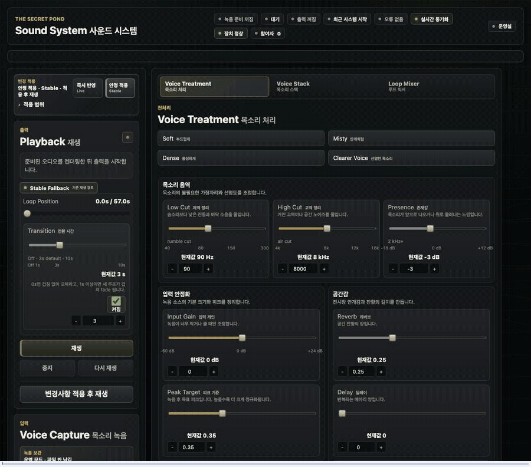
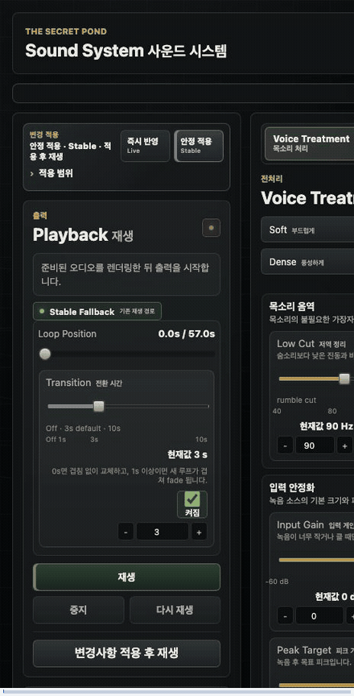
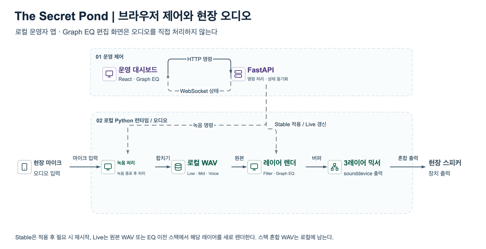
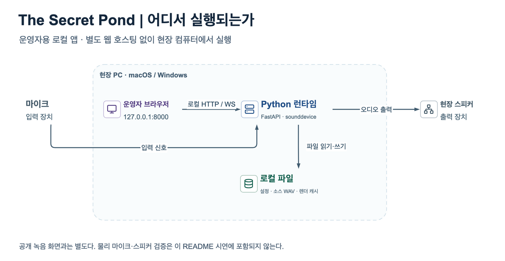
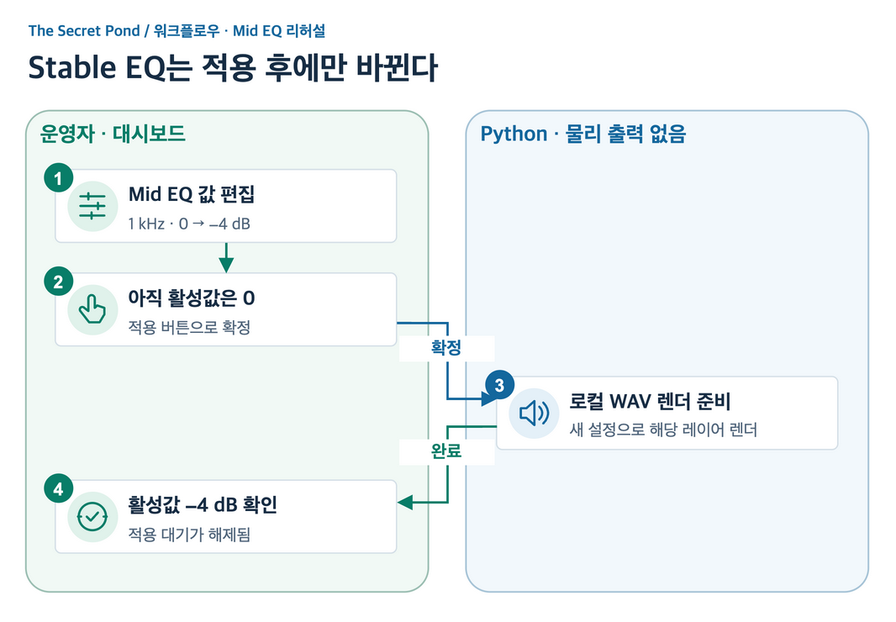
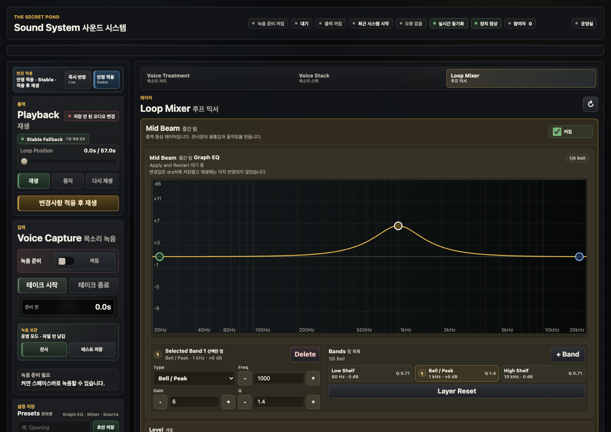

# The Secret Pond Sound System

〈비밀의 연못〉 전시에서 관객의 목소리를 녹음해 반복 음원으로 쌓고, 두 배경음과 섞어 현장 스피커로 재생하는 로컬 사운드 시스템이다.

| | |
| --- | --- |
| 용도 | 전시의 녹음·음원 준비·믹싱을 현장 PC 한 대에서 운영 |
| 담당 범위 | 운영자 대시보드, 녹음 및 WAV 처리, 3레이어 재생, 오디오 장치 점검과 실행 런처 |
| 구현 환경 | Python · FastAPI · WebSocket · React Graph EQ · NumPy/SciPy/Pedalboard · sounddevice |

## 해결한 문제

배경음이 너무 두드러지면 관객 목소리가 묻히지만, 공연 중 EQ를 바꿀 때마다 출력이 끊겨서도 안 된다. 배경음 두 레이어와 누적 목소리를 각각 조절하고, 설정을 미리 편집해 한 번에 적용할지 재생 중 해당 레이어만 바꿀지 운영자가 선택할 수 있게 했다.

## 시연 · 다음 재생에 Mid EQ 적용하기

입장 전 리허설에서 Mid 배경음만 조정한다. **Loop Mixer → Mid Graph EQ → 1 kHz 게인 0 → −4 dB → 변경사항 적용 후 재생.** 곡선을 바꾼 직후에는 적용 대기가 남고, 적용이 끝나면 대기 표시가 사라진 채 −4 dB 곡선이 유지된다.



[시연 단계와 확인 조건](docs/portfolio-readme/docs/demo-scenario.md) · [운영 대시보드 정지 화면](docs/portfolio-readme/assets/readme/secret-pond-workspace.png)

## 운영자 시연 · 관객 목소리를 Voice Stack에 추가하기

운영자가 녹음 준비를 켜고 스페이스바를 누른 뒤 놓는다. 녹음 처리 표시가 사라지고 다음 녹음을 받을 준비 상태로 돌아온다.



[운영자 작업 흐름](docs/portfolio-readme/docs/role-flows.md)

## 운영자가 쓰는 기능

| 작업 | 운영 흐름과 확인 지점 |
| --- | --- |
| 현장 준비 | Source Library에서 Low, Mid, Voice Stack을 선택한다. System에서 소스 준비 여부, 선택된 입출력 장치와 최근 오류를 확인한다. |
| 관객 목소리 쌓기 | 녹음 준비 후 스페이스바를 누른 동안 캡처한다. 3초 미만은 버리고 120초에는 자동으로 멈춘다. Voice Treatment에서 입력 레벨, EQ, 공간감 또는 프리셋을 조절한다. |
| 재생 중 믹싱 | Low·Mid·Voice는 한 출력 스트림으로 들어가며, 볼륨과 음소거·필터·Graph EQ는 레이어마다 조절한다. |
| 리허설 소스 검토 | 리허설 모드에서 Voice Raw를 따로 들어보고 필요한 클립만 스택에 넣는다. 현장 모드에서는 스택에 바로 합친다. |

[Stable 적용 대기 예시](docs/portfolio-readme/assets/readme/secret-pond-eq-stable.png) · [Stable → Live 전환 선택 창](docs/portfolio-readme/assets/readme/secret-pond-eq-live-choice-detail.png)

## 설계 결정

### Stable은 편집과 적용을 나누고, Live는 바뀐 레이어만 교체한다

리허설에선 여러 값을 비교한 뒤 한 번에 확정하고, 현장 운영에선 특정 배경음의 EQ만 조정할 때가 있다. 모든 편집을 곧바로 출력에 적용하면 리허설 중 바꿔 보는 값까지 반영되고, 모든 조정에 전체 재생 재시작이 필요하면 운영 중 손대기 어렵다. Stable에서는 편집값을 따로 저장해 두고, 운영자가 적용을 눌러 새 재생 버퍼가 준비되면 활성값으로 바꾼다. 시연에서도 같은 세션에서 1kHz 값이 활성 0dB·편집 −4dB였다가 적용 뒤 둘 다 −4dB로 바뀌는 것을 확인했다.

Live EQ는 연속 입력이 멈춘 뒤 1초를 기다려 레이어별 최신 요청으로 렌더한다. 이전 EQ 결과에 필터를 거듭 적용하지 않도록 EQ 이전 소스를 읽어 해당 레이어 버퍼만 다시 만들고, 더 새 편집이 들어온 뒤 완료된 이전 작업은 반영하지 않는다. EQ는 이렇게 교체하지만 소스나 루프 길이처럼 재생 버퍼의 전제가 바뀌는 항목은 확정 적용 경로에 남겼다.

### 그래프 조작을 바꿔도 EQ 모델과 렌더는 그대로 유지했다

기존 WEQ8C 기반 인라인 편집기에서 DSSSP로 바꾸면서, 라이브러리의 그래프 숫자와 상태를 곧바로 저장 모델로 삼지 않았다. 그래프에서 읽은 값이 Low·Mid·Voice의 활성값과 어긋나면, 같은 설정을 다시 열었을 때 화면과 소리가 다른 EQ를 가리킬 수 있다. DSSSP는 주파수 응답과 조작점을 보여주는 React 컴포넌트로만 쓰고 기존 대시보드 안에 레이어별로 붙였다.

어댑터는 대시보드의 주파수·게인·Q를 그래프 좌표로 바꾸고, 드래그에서 돌아온 값은 다시 앱의 EQ 모델로 돌려준다. 고정된 셸프와 이동 가능한 벨 포인트의 규칙도 이 경계에 둔다. 드래그 중에는 곡선이 따라오고 드래그가 끝나면 편집을 확정하지만, 실제 DSP와 Live/Stable 적용은 기존 Python 경로를 그대로 사용한다. 그래프 편집기를 바꿔도 프리셋과 레이어별 처리 로직을 함께 교체할 필요가 없다.

### 전시에서 합칠 목소리와 리허설에서 다시 쓸 클립을 나눠 저장했다

전시에서는 받아들인 목소리를 바로 Voice Stack에 더하지만, 리허설에서는 개별 녹음을 들어 보고 원하는 것만 골라 조합한다. 모든 녹음을 원본으로 남기거나 곧장 합치는 한 가지 정책으로는 두 상황을 함께 다루기 어렵다. 현장 모드에서는 개별 원본을 남기지 않고 선택된 Voice Stack WAV를 갱신한다.

리허설 모드에서는 개별 Voice Raw를 저장하고, 운영자가 채택한 녹음만 스택에 넣는다. 채택된 클립과 목록으로 스택을 다시 만들 수 있고, 아직 선택하지 않은 녹음은 현재 재생 결과를 바꾸지 않는다. 현장에서는 합쳐진 스택이 재생 소스이고, 리허설에서는 목소리를 나중에 다시 고를 수 있다는 차이를 저장 구조에 반영했다.

### 세 레이어는 같은 루프 위치에서 전환한다

Low·Mid·Voice의 원본 길이는 서로 달라도 전시에서는 한 덩어리의 소리처럼 반복돼야 했다. 각 파일을 자기 길이대로 반복하면 레이어마다 전환 시점이 달라진다. 그래서 현재 재생 주기는 Voice Stack의 루프 길이를 기준으로 맞추고, 재생기가 세 레이어를 같은 프레임 커서에서 합친다. 원본이 짧으면 정해진 길이까지 반복한다.

페이드는 첫 재생을 늦추는 효과가 아니라 루프 경계를 잇는 데 쓴다. 전환 시간을 켜면 마지막 구간을 낮추는 동안 다음 루프의 처음을 동시에 올리고, 끄면 서로 겹치지 않게 경계에서 넘긴다. 예를 들어 65초 루프에 5초 전환을 두면 다음 루프는 60초 지점에서 들어온다. 이 겹침을 반영해 대시보드의 반복 진행 시간도 같은 기준을 따른다.

[설계 변경과 구현 근거](docs/portfolio-readme/docs/design-evidence.md)

## 시스템과 현장 실행 구조



운영 브라우저가 로컬 FastAPI에 HTTP 명령을 보내고 WebSocket으로 상태를 받는다. 소리는 **마이크 → 캡처 → 로컬 WAV → EQ와 루프 렌더 → sounddevice 믹서 → 스피커**를 따라간다. 서버와 소스·캐시가 현장 PC에 있으므로 별도 클라우드 연결을 전제로 하지 않는 구성이다.

[편집용 draw.io](docs/portfolio-readme/assets/readme/architecture.drawio)

## 현장 인프라



[현장 인프라 draw.io 원본](docs/portfolio-readme/assets/readme/infrastructure.drawio)

## Stable EQ 적용 흐름



[Stable 흐름 draw.io 원본](docs/portfolio-readme/assets/readme/workflow.drawio)

## 로컬 실행

Python 3.11–3.14에서 macOS는 `Start Secret Pond.command`, Windows는 `Start Secret Pond.bat`를 실행한다. 첫 시작에서 가상환경과 의존성을 준비한 후 `http://127.0.0.1:8000`을 연다.

```sh
python -m pip install -e ".[dev]"
secret-pond doctor
secret-pond serve
```

운영 화면과 음원 준비 과정은 저장소의 `docs/operator-guide.md`에 정리했다.

<details>
<summary>기존 설치·개발 안내</summary>

# The Secret Pond Sound System

**〈비밀의 연못〉 전시를 위한 로컬 녹음·루프 재생 시스템.** 운영자가 관객의 목소리를 녹음해 하나의 반복 음원(Voice Stack)에 쌓고, Low·Mid 배경음과 섞어 현장 스피커로 내보낸다.

`Python` · `FastAPI` · `WebSocket` · `NumPy / SciPy / Pedalboard` · `sounddevice`


*로컬에서 실행한 운영자 화면. Low·Mid에는 예시용 합성 WAV를 넣었다.*

## 운영 흐름

### 01. 현장 준비: 음원과 장치 선택

**Source Library**에서 Low·Mid WAV와 사용할 Voice Stack을 고른다. **System**에서 음원 준비 상태, 마이크와 출력 장치, 최근 오류를 확인할 수 있다. 시작할 때 설정과 맞는 재생 캐시가 있으면 불러오고, 없으면 준비된 WAV로 새 렌더링을 시도한다.

### 02. 녹음: 목소리를 하나의 루프로 쌓기

녹음 준비를 켜고 스페이스바를 누른 동안 녹음한다. 키를 놓으면 녹음을 마치고, 3초 미만은 버리며 120초에서 자동으로 멈춘다. 운영자는 Voice Treatment에서 EQ·입력 레벨·공간감 등을 조정하거나 **Soft**, **Misty**, **Dense**, **Clearer Voice** 프리셋을 선택할 수 있다.

| 녹음 보관 모드 | 결과 |
| --- | --- |
| **전시 · `live_ephemeral`** | 녹음을 Voice Stack에 바로 합친다. 개별 Voice Raw는 보관하지 않지만 **합쳐진 스택 WAV는 로컬에 남는다**. |
| **리허설 · `test_library`** | 개별 Voice Raw를 저장해 미리 듣고 선택해서 스택에 추가할 수 있다. 추가된 클립과 목록으로 리허설 스택을 다시 만들 수 있다. |

### 03. 믹싱: Low·Mid·Voice를 따로 조절

세 레이어를 한 출력 스트림에서 재생한다. 레이어별 볼륨, 음소거, 필터 범위와 Graph EQ를 조절할 수 있다. Graph EQ에서는 Bell·Low Shelf·High Shelf와 주파수·게인·Q를 편집한다.



*Stable 모드에서 Mid의 1 kHz를 +6 dB로 편집한 예. 변경은 재생에 반영되기 전이다.*

| EQ 적용 모드 | 동작 |
| --- | --- |
| **Stable** | 변경을 대기 상태에 두고, **변경사항 적용 후 재생**(Apply and Restart)으로 새 렌더를 로드한다. 출력 중이면 잠시 멈췄다가 재개한다. |
| **Live** | 잠깐의 입력 대기 후, **레이어별 최신** EQ 변경만 렌더링한다. 이미 EQ가 적용된 캐시가 아니라 원본 WAV나 EQ 적용 전 Voice Stack에서 새 버퍼를 만들고 해당 레이어를 교체한다. |


*Stable에서 편집 중인 EQ를 Live로 가져갈지 선택하는 화면이다. Low·Mid 음원이나 루프 길이 변경은 계속 재시작을 거친다.*

### 04. 변경 실패 대응: 마지막 적용값 확인

Live 렌더링에 실패하면 경고를 표시하고 마지막으로 적용된 재생 상태를 유지하는 경로를 둔다. Stable 적용 중 오류가 나면 기존 렌더와 재생 상태로 돌아가도록 시도한다. 운영자는 System의 최근 이벤트를 보고 음원·장치를 확인한 뒤 필요하면 Stable로 재적용한다.

## 시스템 구조


브라우저는 HTTP로 녹음·재생·설정 명령을 보내고 WebSocket으로 상태를 받는다. 캡처, WAV 처리, 세 레이어의 믹싱, 장치 출력은 같은 컴퓨터의 Python 런타임에서 처리한다. Graph EQ의 React 편집기는 설정을 조작하는 화면이고, 실제 필터 계산과 오디오 처리는 Python이 맡는다.

[편집용 SVG](docs/portfolio-readme/assets/readme/architecture.svg) · [Mermaid 원본](docs/portfolio-readme/assets/readme/architecture.mmd)

## 실행

Python **3.11–3.14**가 필요하다. macOS는 `Start Secret Pond.command`, Windows는 `Start Secret Pond.bat`로 실행한다. 런처는 첫 실행 시 가상환경과 의존성을 준비하고 로컬 대시보드(`http://127.0.0.1:8000`)를 연다.

터미널에서 실행하려면:

```bash
python -m pip install -e ".[dev]"
secret-pond doctor
secret-pond serve
```

재생하려면 Source Library에 Low·Mid WAV를 추가하고, 녹음하려면 마이크 권한과 입력 장치를 확인한다. `doctor`는 설치·장치·파일 상태를 점검한다. 실제 현장에서는 [장치 및 재생 체크리스트](docs/audio-setup-checklist.md)로 입력과 출력을 별도로 확인한다.

[운영자 가이드](docs/operator-guide.md) · [오디오 점검표](docs/audio-setup-checklist.md)

<details>
<summary>운영 인수인계 및 개발 참고</summary>

**실행과 점검.** 두 런처는 공통 스크립트 [`scripts/launch_secret_pond.py`](scripts/launch_secret_pond.py)를 사용한다. Low와 Mid WAV의 권장 경로는 `data/sources/low/*.wav`, `data/sources/mid/*.wav`다. 로그용 점검은 `secret-pond doctor --json`, 음원을 준비한 뒤 필수 항목 점검은 `secret-pond doctor --strict`로 실행한다.

**재생과 보관.** 활성 설정과 일치하는 렌더 캐시를 시작할 때 다시 사용한다. `다시 재생`은 설정을 적용하지 않고 현재 로드된 재생을 처음부터 시작한다. 대시보드는 `저장 안 된 오디오 변경`과 녹음 최소·최대 시간(min/max duration)을 표시한다. Voice Stack의 `Voice loop`는 스택 길이(loop length) 설정이며 Stable 변경으로 적용한다. 전시 모드의 일반 녹음은 Voice Stack을 직접 갱신한다. 리허설 모드의 일반 녹음은 timestamped Voice Raw source로 저장한다. 리허설 스택을 재구성하려면 앱을 멈춘 뒤 `secret-pond rebuild-test-library --root .`를 실행한다.

**UI 상태관리 원칙.** `currentOperationFlags()`로 작업 중 상태를 모아 잠금을 산출한다. 열려 있는 드롭다운은 불필요하게 다시 렌더링하지 않으며, 버튼이나 메뉴가 활성으로 보여도 실행 직전에 잠금을 한 번 더 확인한다. 변경은 작게 나누고 `fix: 소스 드롭다운 활성 상태 유지`처럼 한글 Conventional Commit을 사용한다.

</details>

</details>
