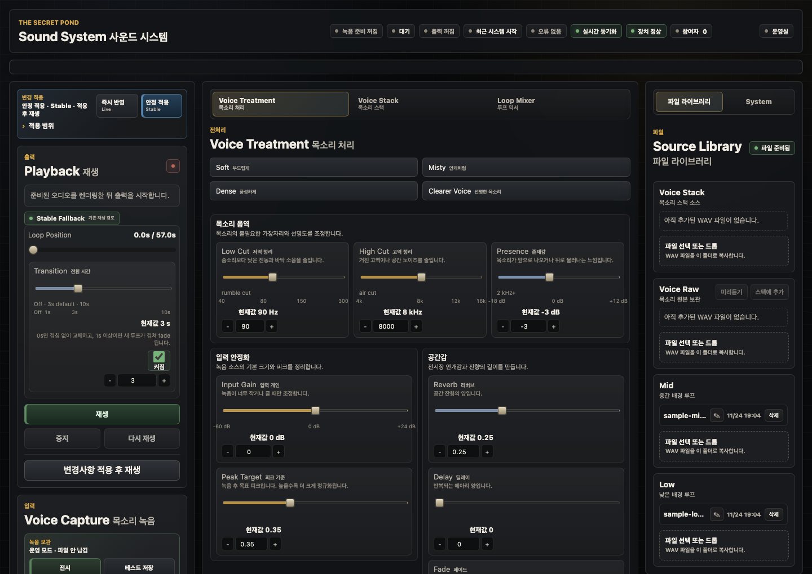
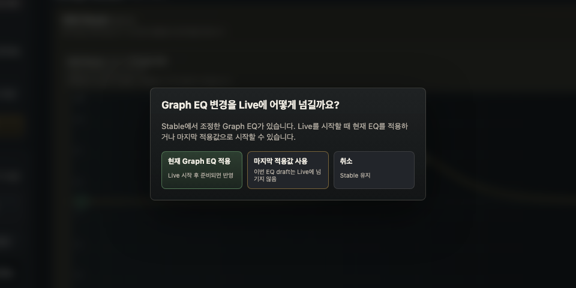
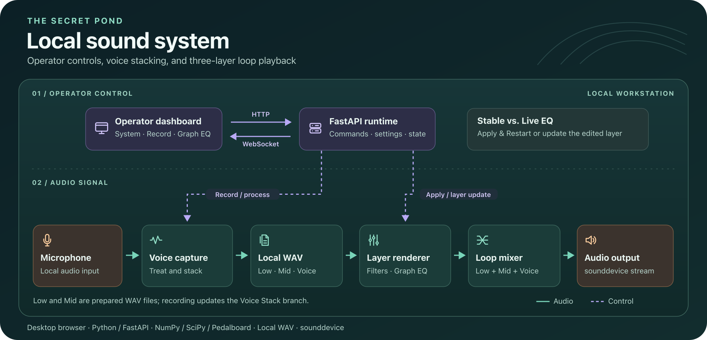

# The Secret Pond Sound System

**〈비밀의 연못〉 전시를 위한 로컬 녹음·루프 재생 시스템.** 운영자가 관객의 목소리를 녹음해 하나의 반복 음원(Voice Stack)에 쌓고, Low·Mid 배경음과 섞어 현장 스피커로 내보낸다.

`Python` · `FastAPI` · `WebSocket` · `NumPy / SciPy / Pedalboard` · `sounddevice`



*로컬에서 실행한 운영자 화면. Low·Mid에는 예시용 합성 WAV를 넣었다.*

## 운영 흐름

### 01. 현장 준비: 음원과 장치 선택

**Source Library**에서 Low·Mid WAV와 사용할 Voice Stack을 고른다. **System**에서 음원 준비 상태, 마이크와 출력 장치, 최근 오류를 확인할 수 있다. 시작할 때 설정과 맞는 재생 캐시가 있으면 불러오고, 없으면 준비된 WAV로 새 렌더링을 시도한다.

### 02. 녹음: 목소리를 하나의 루프로 쌓기

녹음 준비를 켜고 스페이스바를 누른 동안 녹음한다. 키를 놓으면 녹음을 마치고, 3초 미만은 버리며 120초에서 자동으로 멈춘다. 운영자는 Voice Treatment에서 EQ·입력 레벨·공간감 등을 조정하거나 **Soft**, **Misty**, **Dense**, **Clearer Voice** 프리셋을 선택할 수 있다.

| 녹음 보관 모드 | 결과 |
| --- | --- |
| **전시 · `live_ephemeral`** | 녹음을 Voice Stack에 바로 합친다. 개별 Voice Raw는 보관하지 않지만 **합쳐진 스택 WAV는 로컬에 남는다**. |
| **리허설 · `test_library`** | 개별 Voice Raw를 저장해 미리 듣고 선택해서 스택에 추가할 수 있다. 추가된 클립과 목록으로 리허설 스택을 다시 만들 수 있다. |

### 03. 믹싱: Low·Mid·Voice를 따로 조절

세 레이어를 한 출력 스트림에서 재생한다. 레이어별 볼륨, 음소거, 필터 범위와 Graph EQ를 조절할 수 있다. Graph EQ에서는 Bell·Low Shelf·High Shelf와 주파수·게인·Q를 편집한다.


*Stable 모드에서 Mid의 1 kHz를 +6 dB로 편집한 예. 변경은 재생에 반영되기 전이다.*

| EQ 적용 모드 | 동작 |
| --- | --- |
| **Stable** | 변경을 대기 상태에 두고, **변경사항 적용 후 재생**(Apply and Restart)으로 새 렌더를 로드한다. 출력 중이면 잠시 멈췄다가 재개한다. |
| **Live** | 잠깐의 입력 대기 후, **레이어별 최신** EQ 변경만 렌더링한다. 이미 EQ가 적용된 캐시가 아니라 원본 WAV나 EQ 적용 전 Voice Stack에서 새 버퍼를 만들고 해당 레이어를 교체한다. |



*Stable에서 편집 중인 EQ를 Live로 가져갈지 선택하는 화면이다. Low·Mid 음원이나 루프 길이 변경은 계속 재시작을 거친다.*

### 04. 변경 실패 대응: 마지막 적용값 확인

Live 렌더링에 실패하면 경고를 표시하고 마지막으로 적용된 재생 상태를 유지하는 경로를 둔다. Stable 적용 중 오류가 나면 기존 렌더와 재생 상태로 돌아가도록 시도한다. 운영자는 System의 최근 이벤트를 보고 음원·장치를 확인한 뒤 필요하면 Stable로 재적용한다.

## 시스템 구조



브라우저는 HTTP로 녹음·재생·설정 명령을 보내고 WebSocket으로 상태를 받는다. 캡처, WAV 처리, 세 레이어의 믹싱, 장치 출력은 같은 컴퓨터의 Python 런타임에서 처리한다. Graph EQ의 React 편집기는 설정을 조작하는 화면이고, 실제 필터 계산과 오디오 처리는 Python이 맡는다.

[편집용 SVG](assets/readme/architecture.svg) · [Mermaid 원본](assets/readme/architecture.mmd)

## 실행

Python **3.11–3.14**가 필요하다. macOS는 `Start Secret Pond.command`, Windows는 `Start Secret Pond.bat`로 실행한다. 런처는 첫 실행 시 가상환경과 의존성을 준비하고 로컬 대시보드(`http://127.0.0.1:8000`)를 연다.

터미널에서 실행하려면:

```bash
python -m pip install -e ".[dev]"
secret-pond doctor
secret-pond serve
```

재생하려면 Source Library에 Low·Mid WAV를 추가하고, 녹음하려면 마이크 권한과 입력 장치를 확인한다. `doctor`는 설치·장치·파일 상태를 점검한다. 실제 현장에서는 [장치 및 재생 체크리스트](docs/audio-setup-checklist.md)로 입력과 출력을 별도로 확인한다.

[운영자 가이드](docs/operator-guide.md) · [오디오 점검표](docs/audio-setup-checklist.md)

<details>
<summary>운영 인수인계 및 개발 참고</summary>

**실행과 점검.** 두 런처는 공통 스크립트 [`scripts/launch_secret_pond.py`](scripts/launch_secret_pond.py)를 사용한다. Low와 Mid WAV의 권장 경로는 `data/sources/low/*.wav`, `data/sources/mid/*.wav`다. 로그용 점검은 `secret-pond doctor --json`, 음원을 준비한 뒤 필수 항목 점검은 `secret-pond doctor --strict`로 실행한다.

**재생과 보관.** 활성 설정과 일치하는 렌더 캐시를 시작할 때 다시 사용한다. `다시 재생`은 설정을 적용하지 않고 현재 로드된 재생을 처음부터 시작한다. 대시보드는 `저장 안 된 오디오 변경`과 녹음 최소·최대 시간(min/max duration)을 표시한다. Voice Stack의 `Voice loop`는 스택 길이(loop length) 설정이며 Stable 변경으로 적용한다. 전시 모드의 일반 녹음은 Voice Stack을 직접 갱신한다. 리허설 모드의 일반 녹음은 timestamped Voice Raw source로 저장한다. 리허설 스택을 재구성하려면 앱을 멈춘 뒤 `secret-pond rebuild-test-library --root .`를 실행한다.

**UI 상태관리 원칙.** `currentOperationFlags()`로 작업 중 상태를 모아 잠금을 산출한다. 열려 있는 드롭다운은 불필요하게 다시 렌더링하지 않으며, 버튼이나 메뉴가 활성으로 보여도 실행 직전에 잠금을 한 번 더 확인한다. 변경은 작게 나누고 `fix: 소스 드롭다운 활성 상태 유지`처럼 한글 Conventional Commit을 사용한다.

</details>
